# PS3 Virtual Gamepad for RPCS3 on macOS (Apple Silicon)

A free, local-first Android touchscreen game controller (Kotlin + Jetpack Compose) and native macOS companion (Swift/SwiftUI) that exposes a **genuine virtual gamepad** recognized by RPCS3 on Apple Silicon (M-series Macs, macOS 14+ / macOS 27).

---

## Architecture Overview

```mermaid
graph LR
    subgraph Android["Android Client (Kotlin + Jetpack Compose)"]
        UI["Touchscreen UI<br/>(Dual Sticks, PS3 Buttons, D-Pad)"]
        Math["TouchInputMapper<br/>(Deadzone, Clamping, Curves)"]
        Client["GamepadClient<br/>(OkHttp WebSocket, 60Hz Rate Limit)"]
        UI --> Math --> Client
    end

    subgraph Network["Local Wi-Fi Network"]
        WS["WebSocket (ws://<mac-ip>:6000)<br/>Handshake + Heartbeat (500ms)"]
    end

    subgraph MacCompanion["macOS Companion (Swift + SwiftUI)"]
        Server["ControllerServer<br/>(Network.framework TCP/WS)"]
        Validator["ProtocolValidator<br/>(Sequence Monotonicity, Clamping)"]
        Adapter["DriverKitGamerPadAdapter<br/>(Socket.IO Local IPC)"]
        GUI["SwiftUI Dashboard<br/>(Live PS3 HUD & Diagnostics)"]
        Server --> Validator --> Adapter
        Server -.-> GUI
    end

    subgraph System["macOS Kernel & DriverKit"]
        Dext["DriverKit System Extension<br/>(IOHIDUserDevice)"]
        Adapter --> Dext
    end

    subgraph Emulator["RPCS3 PlayStation 3 Emulator"]
        SDL["RPCS3 Input Engine<br/>(libSDL3.0.dylib)"]
        Dext --> SDL
    end

    Client -->|JSON Snapshots| WS --> Server
```



---

## Features

- **Genuine Virtual Gamepad Recognition**: Exposes an authentic HID Gamepad (`IOHIDUserDevice`) via DriverKit that RPCS3 detects natively via SDL3 without keyboard/mouse emulation.
- **Native macOS Companion App**: Includes both a sleek SwiftUI diagnostic window with a real-time DualShock telemetry visualizer and a headless CLI mode (`--headless`).
- **Android Touch Controller**: High-performance Jetpack Compose landscape UI featuring:
  - Dual analog thumbsticks with independent multitouch isolation, radial dead-zone compensation, and smooth curved sensitivity.
  - Classic PS3 action buttons (✕, ○, □, △) with tactile press feedback.
  - Directional Pad (Up, Down, Left, Right).
  - Shoulder bumpers (L1, R1) and triggers (L2, R2).
  - System controls (Select, Start, PS, L3, R3 clicks).
  - In-app network settings dialog with live connection status.
- **Resilient Protocol**: WebSocket transport with authenticated session handshake, sequence number monotonicity, 500ms heartbeat, and automatic neutralizer (releases all inputs if connection drops or idles >1000ms).
- **100% Free & Local-First**: Zero cloud relays, zero accounts, zero analytics, zero paid dependencies.

---

## Compatibility & Validation Status

| Component | Target Environment | Status | Verification Method |
| :--- | :--- | :--- | :--- |
| **Virtual HID Driver** | macOS 27.0.1 / Apple M5 (arm64) | **PASSED** | DriverKit `IOHIDUserDevice` (`CoreOrbits GamerPad`) detected by RPCS3 SDL3 |
| **RPCS3 Input Detection** | RPCS3 `0.0.43-20336 Alpha` | **PASSED** | Real SDL3 dynamic event capture (`spikes/monitor_sdl`) |
| **macOS Companion** | macOS 14.0+ (Xcode 15+, Swift 6) | **PASSED** | 9/9 XCTest unit tests + Clean compilation |
| **Android Controller** | Android 8.0+ (API 26-35) | **PASSED** | 9/9 JUnit unit tests + APK assembled (`app-debug.apk`) |
| **End-to-End Pipeline** | Android ↔ Mac ↔ DriverKit ↔ RPCS3 | **PASSED** | `tests/test_e2e_pipeline.py` (Full automated round-trip) |
| **Resilience & Bounds** | High-rate burst (140 pkt/s), Stale seq rejection | **PASSED** | `tests/test_resilience.py` (6/6 tests passed) |

---

## Quick Start Guide

### 1. Prerequisites on macOS

Ensure DriverKit virtual gamepad support is available. The system extension is pre-approved on macOS:
```bash
# Verify system extension status
systemextensionsctl list
```

### 2. Run the macOS Companion

From the `MacApp/` directory:
```bash
# To run with SwiftUI Diagnostic Dashboard:
swift run MacApp

# Or to run headlessly as a background daemon:
swift run MacApp --headless
```
The companion will display your Mac's local Wi-Fi IP address (e.g., `ws://192.168.1.100:6000`).

### 3. Install & Run the Android App

1. Build or download the debug APK:
```bash
cd AndroidApp
./gradlew assembleDebug
# APK is generated at: AndroidApp/app/build/outputs/apk/debug/app-debug.apk
```
2. Install via ADB or transfer to your Android device:
```bash
adb install -r app/build/outputs/apk/debug/app-debug.apk
```
3. Open **PS3 Controller** on your phone.
4. Tap the **Settings** gear icon in the top bar.
5. Enter your Mac's IP address and tap **Save & Connect**.
6. The status pill will turn **green (CONNECTED)**.

---

## RPCS3 Pad Configuration

1. Launch **RPCS3.app**.
2. Go to **Manage** > **Controllers** (or **Config** > **Pads**).
3. Under **Player 1**:
   - **Handlers**: Select `SDL` (or `Evdev` / `Any`).
   - **Devices**: Select `CoreOrbits GamerPad` (or `PS3 Controller`).
4. You can now press buttons on your Android phone or use the macOS companion's diagnostic test buttons; the corresponding axes and buttons will light up in RPCS3's controller test view.
5. Save your profile and launch your PS3 game!

---

## Running Automated Tests

### macOS Unit Tests
```bash
cd MacApp
swift test
```

### Android Unit Tests
```bash
cd AndroidApp
./gradlew testDebugUnitTest
```

### End-to-End Integration Test
Runs simulated Android input through `MacApp` into DriverKit and captures the resulting events via RPCS3's bundled `libSDL3.0.dylib`:
```bash
python3 tests/test_e2e_pipeline.py
```

### Resilience & Boundary Condition Tests
Tests high-rate packet bursts, stale sequence drops, rogue sessions, and disconnect recovery:
```bash
python3 tests/test_resilience.py
```

---

## Repository Structure

```
├── AndroidApp/                  # Android Controller (Kotlin + Jetpack Compose)
│   ├── app/src/main/            # UI, Models, Math, and WebSocket client
│   └── app/src/test/            # Unit tests for touch math and JSON serialization
├── MacApp/                      # macOS Companion (Swift + SwiftUI)
│   ├── Sources/MacGamepadCore/  # Core protocol, validator, server, and DriverKit adapter
│   ├── Sources/MacApp/          # SwiftUI diagnostic HUD and headless CLI entry
│   └── Tests/MacGamepadCoreTests/# XCTest protocol and state unit tests
├── docs/                        # Architecture, Protocol, Decision Log, Progress
│   ├── ARCHITECTURE.md          # Component contracts and boundaries
│   ├── PROTOCOL.md              # Network wire specification & threat model
│   ├── COMPATIBILITY_MATRIX.md  # Virtual gamepad empirical validation report
│   ├── DECISION_LOG.md          # Architectural decision records
│   └── PROGRESS.md              # Phase tracking and test results
├── spikes/                      # Compatibility test harness (monitor_sdl.c)
├── tests/                       # End-to-end integration and resilience test suites
└── .github/workflows/ci.yml     # Automated CI pipeline
```

---

## Security & Privacy

- **No Cloud Services**: All network communications occur strictly over your local Wi-Fi network directly between your phone and your Mac.
- **Fail-Safe Neutral State**: If the network drops or connection idles for >1000ms, all inputs are immediately neutralized to prevent stuck controller buttons.
- **No Analytics / Telemetry**: Completely tracker-free and open source.

---

## License

This project is licensed under the MIT License. See [LICENSE](LICENSE) for details.
