# PS3 Controller for macOS & RPCS3

An open-source, local-first Android touchscreen controller (Kotlin + Jetpack Compose) and native macOS companion (Swift/SwiftUI) engineered to control PlayStation 3 emulation in **RPCS3** on macOS (optimized for Apple Silicon M-series Macs).

---

## Table of Contents

1. [Overview & Supported Use Cases](#overview--supported-use-cases)
2. [Key Features](#key-features)
3. [Architecture & Input Flow](#architecture--input-flow)
4. [Technology Stack](#technology-stack)
5. [Prerequisites & System Requirements](#prerequisites--system-requirements)
6. [Quick Start with Setup Scripts](#quick-start-with-setup-scripts)
7. [Android Installation (ADB over USB)](#android-installation-adb-over-usb)
8. [macOS Companion Installation](#macos-companion-installation)
9. [RPCS3 Controller Configuration](#rpcs3-controller-configuration)
10. [Controller Layout Customization](#controller-layout-customization)
11. [Connection Transports (USB vs. Wi-Fi)](#connection-transports-usb-vs-wi-fi)
12. [Permissions & Security](#permissions--security)
13. [Troubleshooting & FAQ](#troubleshooting--faq)
14. [Development & Automated Testing](#development--automated-testing)
15. [Repository Structure](#repository-structure)
16. [License & Acknowledgements](#license--acknowledgements)

---

## Overview & Supported Use Cases

The primary use case is playing PlayStation 3 games—such as *God of War III* [BCUS98111]—in **RPCS3** on an Apple Silicon Mac using an Android phone as a high-precision, low-latency PS3 DualShock-style controller.

- **Zero Cloud Dependencies**: Operates entirely over local USB loopback or local Wi-Fi. No accounts, subscriptions, cloud relays, or internet connection required.
- **Low Latency**: Supports USB reverse port forwarding (`adb reverse tcp:6000 tcp:6000`) for sub-millisecond local loopback responsiveness, with automatic fallback to local Wi-Fi.
- **Drift-Free Precision**: Advanced radial deadzone and smooth curve mapping ensure the thumbsticks return to neutral `(0, 0)` immediately upon finger lift.

---

## Key Features

- **Dual Analog Thumbsticks**:
  - Independent multitouch pointer-ID tracking via `awaitEachGesture`.
  - Configurable radial deadzone `[0.0, 0.95]` with smooth exponential remapping.
  - Guaranteed neutral release: releasing one stick never impacts the other, and lift-off packets bypass rate limiting to prevent stuck movement.
- **19 Independently Movable & Resizable Controls**:
  - Every single button (Cross, Circle, Square, Triangle, D-Pad Up/Down/Left/Right, L1, R1, L2, R2, L3, R3, Start, Select, PS) and both analog sticks can be positioned, scaled (50%–200%), nudged, and tuned for sensitivity independently.
  - Moving one D-Pad direction or face button never moves its neighbors.
  - Integrated visual Edit Mode with floating inspector toolbar, individual control reset, and global factory reset.
- **Dual Transport (USB & Wi-Fi)**:
  - **Auto (Prefer USB)**: Connects to `127.0.0.1:6000` over USB when tethered, or falls back to Wi-Fi IP automatically.
  - **Force USB**: Restricts connection to tethered ADB tunnel.
  - **Force Wi-Fi**: Restricts connection to local LAN IP.
- **Direct RPCS3 Input Relay**:
  - Native macOS `CGEventSource(stateID: .hidSystemState)` event tap mimicking physical hardware key presses.
  - Dual mapping for the Right Analog Stick supporting both RPCS3's native `Default.yml` Player 1 navigation keys (Home, End, Forward Delete, Page Down) and standard `IKJL` bindings.
  - Resilient WebSocket streaming with multi-frame packet processing and 8.0-second cutscene timeout protection.
  - Clean state management: all held keys automatically release on disconnect, app pause, or session reset.

---

## Architecture & Input Flow

```mermaid
flowchart LR
    subgraph Android["Android App (Physical Phone)"]
        UI["19 Independent Touch Controls<br/>(D-Pad, Face, Sticks, Shoulders)"]
        Touch["Pointer-ID Touch Isolation<br/>(awaitEachGesture)"]
        Mapper["TouchInputMapper<br/>(Radial Deadzone & Curves)"]
        Client["GamepadClient<br/>(Immediate Neutral Dispatch)"]
        UI --> Touch --> Mapper --> Client
    end

    subgraph Transport["Transport Layer"]
        USB["USB Reverse Tunnel<br/>(adb reverse tcp:6000)"]
        WIFI["Local Wi-Fi WebSocket<br/>(ws://&lt;mac-ip&gt;:6000)"]
        Client -->|Auto-Selected| USB
        Client -.->|Fallback| WIFI
    end

    subgraph MacApp["macOS Companion"]
        Server["ControllerServer<br/>(Stream Parser + 8s Inactivity Guard)"]
        Validator["ProtocolValidator<br/>(Sequence Monotonicity & Clamping)"]
        Adapter["RPCS3DirectInputAdapter<br/>(CGEventSource .hidSystemState)"]
        USB --> Server
        WIFI --> Server
        Server --> Validator --> Adapter
    end

    subgraph Emulator["RPCS3 Emulator"]
        Window["Vulkan Game Canvas<br/>(God of War III)"]
        Adapter -->|WindowServer HID Tap| Window
    end
```



---

## Technology Stack

- **Android Client**:
  - Language: Kotlin 1.9.24
  - UI: Jetpack Compose (BOM 2024.09.00)
  - Networking: OkHttp 4.12.0 (WebSocket)
  - Serialization: Kotlinx Serialization JSON 1.6.3
  - Async: Kotlinx Coroutines 1.8.0
  - Min SDK: Android 8.0 (API 26) / Target SDK: Android 15/16 (API 35-36)
- **macOS Companion**:
  - Language: Swift 6.0
  - Frameworks: Network.framework, CoreGraphics, AppKit, ApplicationServices (Accessibility)
  - Build System: Swift Package Manager (SPM)
  - Minimum macOS: macOS 14.0 (Sonoma) or macOS 15+ (Sequoia) / macOS 27

---

## Prerequisites & System Requirements

### Android Device
- Android 8.0 (API level 26) or higher.
- Developer Options & USB Debugging enabled (for USB mode).
- Data-capable USB cable (must support data transfer, not charge-only).

### Mac Computer
- macOS 14.0 or higher (Apple Silicon M1/M2/M3/M4/M5 recommended).
- Xcode Command Line Tools (`xcode-select --install`).
- Android Debug Bridge (`brew install android-platform-tools`).
- Java Development Kit 17+ (e.g. `brew install openjdk@17`).

---

## Quick Start with Setup Scripts

Automated scripts are located in the `scripts/` directory:

```bash
# 1. Build and package the macOS Companion
./scripts/build-macos.sh

# 2. Install the macOS Companion to /Applications
./scripts/install-macos.sh

# 3. Build the Android APK
./scripts/build-android.sh

# 4. Install APK to connected phone and launch
./scripts/install-android.sh
```

---

## Android Installation (ADB over USB)

### 1. Enable Developer Options on Android
1. Open **Settings** on your phone.
2. Go to **About Phone** (or **Software Information**).
3. Tap **Build Number** 7 times until you see `"You are now a developer!"`.
4. Return to **Settings > System > Developer Options**.
5. Enable **USB Debugging**.

### 2. Connect to Mac & Authorize
1. Connect your phone to your Mac using a USB data cable.
2. An **"Allow USB debugging?"** prompt will appear on your phone screen.
3. Check **"Always allow from this computer"** and tap **Allow**.

### 3. Verify Connection in Terminal
```bash
adb devices
```
Expected output:
```text
List of devices attached
10BD12000X00011    device
```
*(If it shows `unauthorized`, unlock your phone and accept the RSA prompt. If empty, try another USB cable/port).*

### 4. Build & Install the APK
From the project root:
```bash
# Configure zero-latency USB port forwarding
adb reverse tcp:6000 tcp:6000

# Build debug APK using Gradle
cd AndroidApp
./gradlew assembleDebug
cd ..

# Install onto your phone
adb install -r AndroidApp/app/build/outputs/apk/debug/app-debug.apk

# Launch the app
adb shell am start -n com.antigravity.ps3controller/.MainActivity
```

---

## macOS Companion Installation

### 1. Build the Release Binary & Application Bundle
```bash
# Build release binary and bundle into MacApp/build/PS3ControllerCompanion.app
./scripts/build-macos.sh
```

### 2. Install to Applications
```bash
./scripts/install-macos.sh
```
This installs `PS3ControllerCompanion.app` into `/Applications` (or `~/Applications` if permissions are restricted).

### 3. Grant Accessibility Permissions
macOS requires Accessibility permissions for synthetic input injection:
1. Open **System Settings > Privacy & Security > Accessibility**.
2. Click **+** and add **PS3 Controller Companion** (or ensure your **Terminal** app is checked if running in CLI mode).
3. Toggle the permission to **ON**.

### 4. Launch the Companion
You can launch either the graphical app or the headless daemon:
```bash
# Graphical Dashboard:
open /Applications/PS3ControllerCompanion.app

# Or Headless Daemon (via Terminal):
/Applications/PS3ControllerCompanion.app/Contents/MacOS/PS3ControllerCompanion --headless
```

---

## RPCS3 Controller Configuration

### 1. Open Controller Settings in RPCS3
1. Launch **RPCS3**.
2. Click **Pads** in the top toolbar (or select **Configuration > Pads**).
3. Ensure **Player 1** tab is selected.

### 2. Configure Input Handler
- Set **Handler**: `Keyboard`
- Set **Device**: `Keyboard`

### 3. Verify Key Mappings
The companion app translates controller states to RPCS3's native Player 1 keyboard profile (`Default.yml`):

| PS3 Controller Input | Mac Key Emulated | RPCS3 Player 1 Binding | In-Game Action (God of War III) |
|---|---|---|---|
| **Cross (✕)** | `X` (keycode 7) | `X` | Jump / Confirm |
| **Circle (○)** | `C` (keycode 8) | `C` | Grab / Interact / Cancel |
| **Square (□)** | `Z` (keycode 6) | `Z` | Light Attack |
| **Triangle (△)** | `V` (keycode 9) | `V` | Heavy Attack |
| **L1 Bumper** | `Q` (keycode 12) | `Q` | Block / Parry |
| **R1 Bumper** | `E` (keycode 14) | `E` | Weapon Special / Magic |
| **L2 Trigger** | `R` (keycode 15) | `R` | Bow of Apollo / Secondary |
| **R2 Trigger** | `T` (keycode 17) | `T` | Rage of Sparta |
| **L3 Stick Click** | `F` (keycode 3) / Shift | `F` | Sprint / Ability |
| **R3 Stick Click** | `G` (keycode 5) | `G` | Target Lock / Camera Reset |
| **Start** | `Return` (keycode 36) | `↵` (Return) | Pause / Upgrades |
| **Select** | `Space` (keycode 49) | `Space` | Status / Weapons |
| **PS Button** | `Backspace` (keycode 51) / Esc | `⌫` (Backspace) | XMB / System Menu |
| **D-Pad Up (▲)** | `Up Arrow` (keycode 126) | `↑` | Weapon Up |
| **D-Pad Down (▼)** | `Down Arrow` (keycode 125) | `↓` | Weapon Down |
| **D-Pad Left (◀)** | `Left Arrow` (keycode 123) | `←` | Weapon Left |
| **D-Pad Right (▶)** | `Right Arrow` (keycode 124) | `→` | Weapon Right |
| **Left Stick Up** | `W` (keycode 13) | `W` | Move Forward |
| **Left Stick Down** | `S` (keycode 1) | `S` | Move Backward |
| **Left Stick Left** | `A` (keycode 0) | `A` | Move Left |
| **Left Stick Right** | `D` (keycode 2) | `D` | Move Right |
| **Right Stick Up** | `Home` (115) / `I` (34) | `↖` (Home) | Camera Up / Roll Forward |
| **Right Stick Down** | `End` (119) / `K` (40) | `↘` (End) | Camera Down / Roll Backward |
| **Right Stick Left** | `Delete` (117) / `J` (38) | `⌦` (Delete) | Camera Left / Roll Left |
| **Right Stick Right** | `Page Down` (121) / `L` (37) | `⇟` (Page Down) | Camera Right / Roll Right |

### 4. Window Focus Requirement
Because keyboard emulation uses macOS system event delivery, **RPCS3's Vulkan rendering window must have focus** to receive gameplay input. Click anywhere inside the game window once when launching to ensure it is the active application.

---

## Controller Layout Customization

Every button and analog stick can be moved, resized, and configured independently:

1. Tap **Edit Buttons** in the top navigation bar.
2. Select any control by tapping it on screen, or use the `←` and `→` arrows in the floating toolbar.
3. **Move**: Drag the selected control anywhere across the screen, or use the **Nudge** buttons (`←`, `↑`, `↓`, `→`) for 5px fine adjustments.
4. **Resize**: Drag the **Size** slider (50% to 200%) or use `[-]` and `[+]`.
5. **Sensitivity**: Adjust the **Sens** slider (0.2x to 3.0x) for individual touch responsiveness.
6. **Reset Single Control**: Tap **Reset Control** to revert only the currently selected element to default.
7. **Reset All**: Tap **Reset All** to restore the factory default layout.
8. Tap **Done** to save the layout. Settings persist automatically across app restarts.

---

## Connection Transports (USB vs. Wi-Fi)

The application supports both USB and Wi-Fi connections:

| Mode | Transport | Typical Latency | Best For | Setup Requirement |
|---|---|---|---|---|
| **Auto (Default)** | USB loopback with Wi-Fi fallback | `< 1 ms` (USB) / `3–8 ms` (Wi-Fi) | General play | `adb reverse tcp:6000 tcp:6000` |
| **Force USB** | `127.0.0.1:6000` | `< 1 ms` | High-stakes gameplay | USB cable attached |
| **Force Wi-Fi** | `ws://<Mac-IP>:6000` | `3–8 ms` | Wireless couch play | Both devices on same Wi-Fi |

To switch modes, tap the **Settings (⚙️)** icon in the top right of the Android screen and choose your preferred transport priority.

---

## Permissions & Security

- **No Root Required**: The Android app runs entirely within standard user permissions.
- **No Kernel Extensions**: The macOS companion runs entirely in userspace using Apple's official `Network.framework` and `CoreGraphics` APIs.
- **Accessibility Authorization**: Required by macOS for the companion to post synthetic keystrokes to RPCS3.
- **Local Network Only**: Communication is strictly point-to-point across your local network or USB cable. No telemetry or analytics are collected.

---

## Troubleshooting & FAQ

| Problem | Cause | Solution |
|---|---|---|
| `adb: command not found` | Android platform tools not in PATH | Run `brew install android-platform-tools` |
| Device shows `unauthorized` in `adb devices` | Phone RSA prompt not accepted | Unlock phone screen and tap **Allow** on the debugging prompt |
| Android shows `DISCONNECTED` (USB) | Port forwarding not configured | Run `adb reverse tcp:6000 tcp:6000` in Terminal |
| Android shows `ERROR` (Wi-Fi) | Mac firewall or wrong IP | Verify Mac Wi-Fi IP in Settings dialog; ensure port 6000 is open |
| Controller doesn't respond in RPCS3 | RPCS3 window lacks focus | Click inside the RPCS3 Vulkan game window |
| Keystrokes not received | Accessibility permission missing | Enable companion in **System Settings > Privacy & Security > Accessibility** |
| Analog stick keeps moving after release | Previously fixed in master patch | Update to latest version; verify `awaitEachGesture` neutral dispatch is active |

---

## Development & Automated Testing

### Android Unit Tests
```bash
cd AndroidApp
./gradlew testDebugUnitTest
```
Tests cover:
- Monotonic stick math & radial deadzones (`TouchInputMapperTest.kt`).
- JSON state serialization & sequence monotonicity (`ControllerStateSerializationTest.kt`).
- Independent layout movement, resizing, and legacy migration (`IndependentControlsLayoutTest.kt`).

### macOS Unit Tests
```bash
cd MacApp
swift test
```
Tests cover:
- Protocol encoding/decoding and validator boundaries (`ProtocolTests.swift`).
- Simultaneous dual-stick axis validation.
- `RPCS3DirectInputAdapter` lifecycle and neutral release.

---

## Repository Structure

```text
.
├── AndroidApp/                       # Android application (Kotlin + Compose)
│   ├── app/
│   │   ├── src/main/java/com/antigravity/ps3controller/
│   │   │   ├── MainActivity.kt       # Activity lifecycle & settings integration
│   │   │   ├── math/TouchInputMapper.kt  # Radial deadzone & curve calculations
│   │   │   ├── model/LayoutConfig.kt     # 19 independent control layout models
│   │   │   ├── model/ProtocolModels.kt   # JSON state protocol models
│   │   │   ├── network/GamepadClient.kt  # WebSocket client with neutral bypass
│   │   │   └── ui/                   # Jetpack Compose UI & components
│   │   └── src/test/                 # Android unit test suites
│   └── build.gradle.kts
├── MacApp/                           # Native macOS companion (Swift + SPM)
│   ├── Package.swift
│   ├── Sources/
│   │   ├── MacApp/                   # SwiftUI dashboard & CLI launcher
│   │   └── MacGamepadCore/           # Core server & RPCS3 input adapter
│   └── Tests/MacGamepadCoreTests/    # Swift XCTest suites
├── docs/                             # Architecture & compatibility documentation
│   ├── ARCHITECTURE.md
│   ├── COMPATIBILITY_MATRIX.md
│   ├── DECISION_LOG.md
│   └── PROGRESS.md
├── scripts/                          # One-command build & install scripts
│   ├── build-android.sh
│   ├── install-android.sh
│   ├── build-macos.sh
│   └── install-macos.sh
├── LICENSE                           # MIT License
└── README.md                         # This documentation
```

---

## License & Acknowledgements

- **License**: Released under the [MIT License](LICENSE).
- **RPCS3**: Special thanks to the RPCS3 team for their PlayStation 3 emulator.
